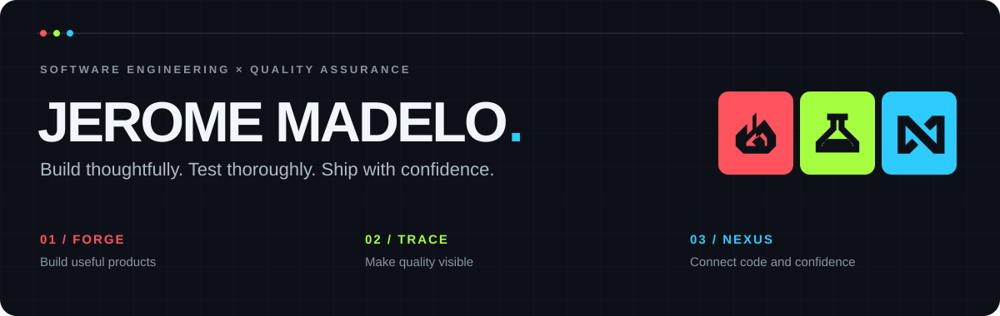

  

  <strong>Software Engineer · Software QA Engineer · Test Automation</strong> 
  San Jose del Monte, Bulacan, Philippines

  <a href="https://qa-test-dashboard.vercel.app/">Explore my QA dashboard</a> &nbsp; / &nbsp;
  <a href="https://www.linkedin.com/in/romemadelo/">LinkedIn</a> &nbsp; / &nbsp;
  <a href="mailto:romemadelo@gmail.com">Let's talk</a>

---

### Hey, I'm Rome.

I build web applications and the automated tests that help teams release them with confidence. My work connects **software development, test automation, and clear reporting** — from a reusable Playwright fixture to a dashboard that explains what failed and where to look.

Currently a **QA Engineer at Glophics Web Design & Advertising Inc.**, following my work at **Tsukiden Global Solutions, Inc.**

### Three perspectives. One engineering mindset.

| 🔴 FORGE · Development | 🟢 TRACE · Quality | 🔵 NEXUS · Engineering |
| :--- | :--- | :--- |
| Turn ideas into useful web applications and internal tools. | Design dependable checks and investigate failures with evidence. | Connect applications, automation, and delivery into a coherent system. |
| Next.js · React · TypeScript | Playwright · Selenium · Postman | REST APIs · Supabase · GitHub Actions |

### Selected work

#### [QA Test Automation & Monitoring ↗](https://qa-test-dashboard.vercel.app/)
A Next.js dashboard with a Supabase backend for the Musticker Playwright suite.

- **Understand quality:** run history, pass-rate trends, flaky tests, reliability, and failure triage.
- **Control execution:** GitHub Actions dispatch, scheduled runs, and environment health checks.
- **Share evidence:** per-run results, attachments, printable reports, and CSV exports.
- **Keep boundaries clear:** dashboard and tests live in separate repositories, connected through reporter HTTP calls and workflow dispatch.

[Live dashboard](https://qa-test-dashboard.vercel.app/) · [Playwright test repository](https://github.com/romemadeloo/musticker-e2e)

#### [Musticker E2E ↗](https://github.com/romemadeloo/musticker-e2e)
Maintainable storefront automation with Playwright and TypeScript, reusable fixtures and page objects, cross-browser coverage, and CI reporting.

#### [Glophics Portal ↗](https://glophics-portal.vercel.app/)
An internal tool for QA environment claims, Jira ticket visibility, branch conflicts, and endpoint health checks.

### My toolkit

**Build** &nbsp; TypeScript · JavaScript · React · Next.js · Vue.js · Nuxt.js · Laravel · Supabase  
**Test** &nbsp; Playwright · Selenium · Python · Postman · Functional, regression, smoke & API testing  
**Deliver** &nbsp; Git · GitHub Actions · Allure · AWS CodeBuild · Jira · Vercel

### How I approach quality

- Start with user journeys and risk; automate the scenarios that matter most.
- Keep tests isolated, readable, and reusable with fixtures and page objects.
- Prefer stable locators and meaningful assertions over fragile timing.
- Investigate flaky checks and preserve traces, screenshots, and reports.
- Make results useful to the people deciding whether to ship.

<strong>Websites I test and automate</strong>

 

[StickerJapan](https://www.stickerjapan.com/) ·
[OzStickerPrinting](https://www.ozstickerprinting.com/) ·
[StickerMarket](https://www.stickermarket.co.uk/) ·
[SingaPrinting](https://www.singaprinting.com/) ·
[StickerCanada](https://www.stickercanada.com/) ·
[AllStickerPrinting](https://www.allstickerprinting.com/) ·
[Musticker](https://www.musticker.com/) ·
[StickerDot](https://www.stickerdot.co.nz/)

---

<strong>Let's engineer software you can trust.</strong> Open to software engineering, QA, and test automation opportunities.

